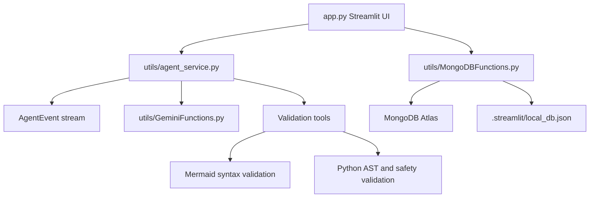

# Revised Implementation Plan: Agentic Automation Generator

This plan upgrades the existing Streamlit Automation Generator from a linear set of Gemini calls into an agent-style orchestration workflow while preserving the current PDF validation, Mermaid fallback generation, MongoDB/vector search, and local JSON fallback behavior.

## 1. Target Outcome

The upgraded app should:

1. Generate a complete automation package from an SOP PDF: summary, Mermaid flowchart, Python automation script, unit tests, and prerequisites.
2. Run generation through a single orchestration layer that can validate outputs and retry failed components.
3. Show real-time progress in Streamlit using user-safe status events, tool names, validation results, and retry messages.
4. Avoid hard application exits when Gemini, MongoDB, embeddings, or search indexes are unavailable.
5. Keep existing search, vector admin, local fallback, download, and save flows working.

## 2. Important Corrections To The Original Plan

1. `requirements.txt` already includes `google-antigravity`, so the first dependency task is verification, not blindly appending it.
2. `utils/MongoDBFunctions.py` already has `connection_active`, local JSON read/write, local search, local stats, and local save support. The implementation should harden and expose these paths rather than recreate them.
3. The current highest-risk hard stops are in:
   - `app.py` component initialization and validation paths.
   - `utils/GeminiFunctions.py` API initialization.
4. “Agent thoughts” should not be promised as raw private chain-of-thought. The UI should stream safe operational events: step names, tool inputs at a high level, validation status, retry count, and final component status.
5. The Google Antigravity SDK API shape must be confirmed before implementation. If the installed package/API differs from the assumed import path, the orchestration layer should still support the same app-facing interface.

## 3. Proposed Architecture



The key design choice is to make `agent_service.py` the orchestration boundary. `app.py` should not know whether generation is handled by the Antigravity SDK, the existing Gemini wrapper, or a fallback orchestrator. It should consume a stable event stream and final result object.

## 4. Implementation Phases

### Phase 0: SDK And Runtime Verification

Goal: verify whether `google-antigravity` is installable/importable and what API it exposes.

Tasks:

1. Inspect the installed package or install from `requirements.txt` if missing.
2. Confirm import path, agent creation API, tool registration API, streaming API, and model configuration.
3. Document the confirmed SDK contract in a short comment/docstring inside `utils/agent_service.py`.
4. If the SDK is unavailable or incompatible, implement a local orchestrator with the same public interface so the app remains usable.

Acceptance criteria:

1. `python -c "import ..."` confirms the actual import path or records a clear fallback.
2. The app-facing orchestration API is defined before UI changes.

### Phase 1: Create Agent Service Boundary

Add `utils/agent_service.py`.

Core objects:

1. `AutomationRequest`
   - `pdf_text`
   - `domain`
   - `extra_info`
   - `complexity`
   - `include_tests`
   - `script_language`
   - `include_comments`

2. `AutomationResult`
   - `summary`
   - `mermaid_diagram`
   - `block_diagram`
   - `script`
   - `unit_tests`
   - `prerequisites`
   - `validation_report`
   - `generation_mode`

3. `AgentEvent`
   - `type`: `status`, `tool_start`, `tool_result`, `validation`, `retry`, `error`, `complete`
   - `message`
   - `step`
   - `metadata`

4. `AutomationAgentService`
   - `run(request) -> AutomationResult`
   - `stream(request) -> Iterator[AgentEvent | AutomationResult]`

Generation tools:

1. `generate_summary`
2. `generate_mermaid_diagram`
3. `generate_script`
4. `generate_unit_tests`
5. `generate_prerequisites`
6. `validate_mermaid`
7. `validate_script`

Acceptance criteria:

1. The service can run with the current `GenerativeFunction` methods.
2. The service emits safe, structured progress events.
3. The final result can be passed directly to the existing `display_automation_results` function.

### Phase 2: Add Self-Healing Validation

Mermaid validation:

1. Reuse existing generation cleanup in `GeminiFunctions.py`.
2. Validate that output starts with `flowchart`.
3. Reject code fences, explanatory text, unbalanced brackets/braces, and unsafe labels.
4. Attempt up to 2 correction retries.
5. Fall back to `FlowchartGenerator.generate_automation_flowchart(...)`.

Script validation:

1. Strip Markdown code fences before validation.
2. Parse generated Python with `ast.parse`.
3. Run the existing dangerous-pattern safety checks.
4. Reject hardcoded secrets patterns where practical.
5. Attempt up to 2 correction retries.
6. Return the best generated script with validation warnings if correction cannot fully pass.

Unit test validation:

1. Ensure tests are present only when `include_tests` is true.
2. Prefer `unittest` or `pytest` syntax consistently.
3. Parse tests with `ast.parse` after code fence stripping.

Acceptance criteria:

1. Invalid Mermaid is automatically corrected or replaced by fallback.
2. Invalid Python triggers retry before being shown.
3. Validation outcomes appear in the UI event console and final report.

### Phase 3: Refactor Streamlit Generation Flow

Modify `app.py`.

Tasks:

1. Keep `st.set_page_config` as the first Streamlit page command.
2. Initialize `AutomationAgentService` in `init_components`.
3. Replace the current generate-button sequence with `agent_service.stream(request)`.
4. Add a real-time agent console using Streamlit-native containers, expanders, progress bars, and status lines.
5. Store generated result in `st.session_state` so reruns do not immediately regenerate.
6. Continue using `display_automation_results(...)` for final display, with small changes only if needed.

UI event console should display:

1. Current step.
2. Tool started/completed.
3. Validation passed/failed.
4. Retry attempts.
5. Fallback usage.
6. Final completion status.

Acceptance criteria:

1. Uploading and validating a PDF still works.
2. Summary generation is no longer a separate blocking pre-step unless intentionally kept as “preview summary.”
3. Generated outputs render in the existing tabs.
4. Streamlit reruns do not duplicate expensive generation unless the user clicks regenerate.

### Phase 4: Remove Hard Stops And Improve Degraded Modes

Modify `app.py` and `utils/GeminiFunctions.py`.

Tasks:

1. Replace `st.stop()` in component initialization with typed failure states where possible.
2. In `GenerativeFunction._initialize_api`, avoid stopping the whole app when `API_KEY` is missing. Mark the Gemini client unavailable and surface a clear UI warning.
3. Disable generation buttons when Gemini is unavailable, while keeping search/local database views usable.
4. In validation paths, replace hard stop with a clear validation failure panel and return to the form.
5. In the sidebar, explicitly show:
   - MongoDB connected or local fallback.
   - Vector search enabled or keyword/local search active.
   - Gemini available or generation disabled.

Acceptance criteria:

1. App starts without MongoDB secrets.
2. App starts without Gemini secrets.
3. Search works against local JSON when MongoDB is unavailable.
4. Generate controls are disabled or explain why they cannot run when Gemini is unavailable.

### Phase 5: Harden MongoDB Local Fallback

`MongoDBFunctions.py` already has local fallback support. Improve it rather than duplicating it.

Tasks:

1. Ensure `_add_solution_locally` saves `unit_tests`.
2. Ensure local documents use stable IDs, preferably UUIDs instead of list length.
3. Search local fields consistently across `domain`, `summary`, `extra_info`, `script`, and `prerequisites`.
4. Avoid mutating local result dictionaries in place during search if that affects saved data.
5. Make connection status easy for `app.py` to display.

Acceptance criteria:

1. Saved local results include every generated artifact.
2. Local search can find results by script/prerequisite terms.
3. Local fallback stats and search do not crash on malformed JSON or empty files.

### Phase 6: Tests

Add or update tests.

Recommended tests:

1. `tests/test_agent_workflow.py`
   - Mock `GenerativeFunction`.
   - Verify all components are generated.
   - Verify event stream order.
   - Verify Mermaid retry/fallback behavior.
   - Verify script validation retry behavior.

2. `tests/test_local_fallback.py`
   - Verify local save includes `unit_tests`.
   - Verify local search covers all expected fields.
   - Verify local stats with empty and populated JSON.

3. Existing tests:
   - Run `python tests/test_vector_search.py`.
   - Run any admin/secrets tests that do not require real production credentials.

Acceptance criteria:

1. New tests pass without real Gemini or MongoDB credentials.
2. Existing vector/search tests still pass or have documented credential/index prerequisites.

## 5. Manual Verification Checklist

1. Start app:

   ```bash
   streamlit run app.py
   ```

2. Verify app startup with valid secrets.
3. Verify app startup with missing MongoDB URI.
4. Verify app startup with missing Gemini API key.
5. Upload a valid text-based SOP PDF and generate automation.
6. Confirm the event console shows safe progress events and validation results.
7. Confirm Mermaid renders in light and dark themes.
8. Confirm script/tests/prerequisites downloads work.
9. Save to MongoDB when connected.
10. Save to `.streamlit/local_db.json` when disconnected.
11. Search saved local and MongoDB results.

## 6. Main Risks And Mitigations

1. Antigravity SDK API mismatch
   - Mitigation: build `AutomationAgentService` with a stable local interface and fallback orchestrator.

2. Streamlit rerun behavior causing repeated generation
   - Mitigation: use explicit session-state request IDs and cached result state.

3. Raw agent thought exposure
   - Mitigation: stream safe operational events only.

4. Generated code safety
   - Mitigation: combine pattern checks with AST parsing and warning reports.

5. Mermaid rendering fragility
   - Mitigation: validate, retry, clean, and fall back to template generator.

6. Credential-free startup
   - Mitigation: typed component availability flags and disabled generation controls.

## 7. Recommended Implementation Order

1. Verify SDK/imports and define `agent_service.py` interface.
2. Implement local fallback orchestrator using existing Gemini methods.
3. Add validation and retry tools.
4. Add tests for agent orchestration and local fallback.
5. Refactor `app.py` generation UI to consume the event stream.
6. Remove remaining hard stops and add degraded-mode status indicators.
7. Run automated tests and manual Streamlit verification.

## 8. Decision Needed Before Coding

Choose the generation UX:

1. Fully autonomous generation: one click generates all artifacts with progress events.
2. Review-gated generation: generate summary first, then require user approval before script/diagram/tests/prerequisites.

Recommendation: implement fully autonomous generation first, while preserving the summary preview as an optional rerun state. It demonstrates the agentic workflow clearly and keeps the UI simpler.
